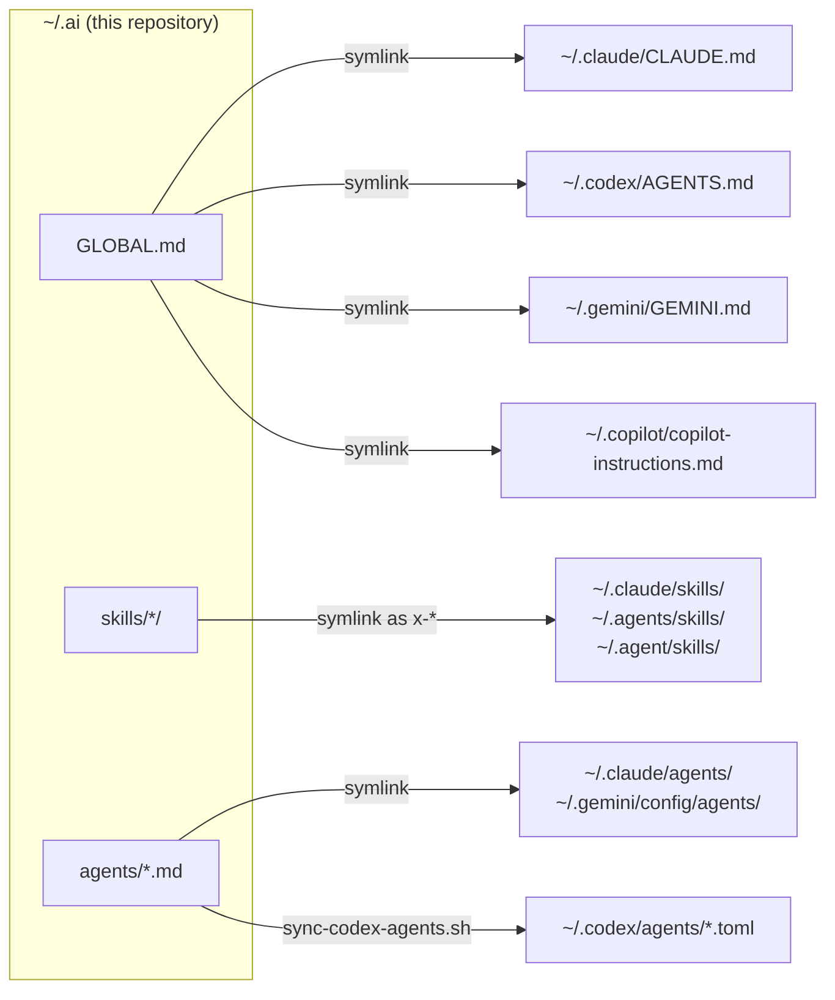

# Global AI Setup

A unified configuration system for AI coding agents, shared skills, and development workflows.

Write your agent instructions, skills, and subagents once in `~/.ai`, and link them into Claude Code, Codex CLI, Antigravity (Gemini), and GitHub Copilot.

**Who it's for:** developers who use more than one AI coding agent and want the same baseline behavior in all of them without copying files between tool folders.

## Key features

* **One global instruction file.** `GLOBAL.md` is linked as `CLAUDE.md`, `AGENTS.md`, `GEMINI.md`, and `copilot-instructions.md`.
* **Shared skills.** 13 skills under `skills/`, covering docs lookup, BFF authentication, design patterns, browser checks, release checks, issue tracking, and more. See [docs/skills.md](docs/skills.md).
* **Shared subagents.** Builder, debugger, frontend validator, security reviewer, and verifier. See [docs/agents.md](docs/agents.md).
* **Codex agent generation.** Markdown agents are converted to the TOML format Codex needs.
* **Safe bootstrap.** A dry-run mode, plus backups of files it replaces.
* **Health check.** `doctor.sh` checks links, skills, agents, script syntax, JSON/TOML configs, and installed CLIs.

## Architecture



`~/.ai` is the single source of truth. Tool folders hold links to it, or files generated from it. Edit a file in `~/.ai` and every linked tool sees the change.

### Notable decisions

* **Links, not copies.** `bootstrap.sh` creates symlinks, so there is nothing to keep in sync, except the Codex agents, which have to be generated.
* **Codex agents are generated.** Codex needs TOML, so `scripts/sync-codex-agents.sh` turns the description, body, and `codex-*` frontmatter keys of each `agents/*.md` into `~/.codex/agents/<name>.toml`. The sandbox defaults to `read-only` unless an agent sets `codex-sandbox`.
* **Small global context.** `GLOBAL.md` only holds behavior useful in nearly every session: scope, evidence-first investigation, minimal changes, verification, safety, and concise communication. Framework and project knowledge lives in skills or in each project.
* **Skills load on demand.** Most skills are user-invoked only (`disable-model-invocation: true`), so they don't use up context until you call them with `/x-<name>`.
* **Safety lives in tool permissions, not prompts.** Rules such as "approval before push" and "no force push or `git reset --hard`" belong in each tool's permission settings. This repository doesn't manage those settings.
* **CLIs over context-heavy MCP servers.** It uses the Context7 CLI and Playwright CLI instead of their MCP servers.
* **Token-efficient tooling.** RTK compresses shell and tool output, and the Ponytail Claude plugin encourages smaller implementations. `doctor.sh` reports whether both are present.
* **Project knowledge stays in the project.** Architecture, commands, and specs belong in each repository (for example via OpenSpec), not in global config.

## Compatibility

What `bootstrap.sh` sets up for each tool:

* **Claude Code:** `~/.claude/CLAUDE.md`, `~/.claude/skills/x-*`, `~/.claude/agents/*.md`
* **Codex CLI:** `~/.codex/AGENTS.md`, `~/.codex/agents/*.toml` (generated)
* **Antigravity / Gemini:** `~/.gemini/GEMINI.md`, `~/.gemini/config/agents/*.md`
* **GitHub Copilot:** `~/.copilot/copilot-instructions.md` (global instructions only)
* **Shared skill folders:** `~/.agents/skills/x-*` and `~/.agent/skills/x-*`

Requirements:

* Bash, Git, and a system that supports symlinks. The scripts expect the repository at `~/.ai`.
* Optional, for `doctor.sh`: `jq` (JSON checks), Python 3.11+ (`tomllib`, for TOML checks), and `shellcheck`.
* Optional, used by some skills: `ctx7` (Context7 CLI), `playwright-cli`, `rtk`, and a `TYPESAFE_API_KEY` for `x-model-router`.

The scripts have been run on Linux with Bash 5.2 and on macOS with the system Bash 3.2. Windows isn't supported natively, because bootstrap relies on Bash and symlinks in your home folder.

## Quick start

```bash
git clone https://github.com/themkvz/global-ai-setup.git ~/.ai
```

Preview what bootstrap would change (nothing is written):

```bash
DRY_RUN=1 ~/.ai/bootstrap.sh
```

Apply:

```bash
~/.ai/bootstrap.sh
```

Check the result:

```bash
~/.ai/scripts/doctor.sh
```

A healthy setup ends with `Failures: 0`. A warning usually means an optional CLI isn't installed.

What bootstrap does with files that already exist:

* **An existing `CLAUDE.md`, `AGENTS.md`, `GEMINI.md`, `copilot-instructions.md`, or agent file** is moved to `<file>.backup` (or `<file>.backup.<timestamp>` if a backup exists) before the link is created.
* **An existing skill folder that is not a symlink** is left alone and reported as `Skip existing non-symlink`.
* **Existing symlinks** are replaced.

Bootstrap doesn't touch tool permissions, credentials, authentication, or other local-only settings.

## Usage

* Global instructions: edit `~/.ai/GLOBAL.md`.
* Skills: run a user-invoked skill with `/x-<name>`, for example `/x-ship-check` or `/x-wait-what`. Full list: [docs/skills.md](docs/skills.md).
* Agents: after changing `agents/*.md`, regenerate the Codex copies:

  ```bash
  ~/.ai/scripts/sync-codex-agents.sh
  ```

## Repository layout

```text
~/.ai/
├── GLOBAL.md                     global instructions for every tool
├── bootstrap.sh                  creates links and generated config
├── agents/                       shared subagents (Markdown + frontmatter)
├── skills/<name>/SKILL.md        shared skills, some with references/
├── scripts/
│   ├── doctor.sh                 health check
│   └── sync-codex-agents.sh      agents/*.md → ~/.codex/agents/*.toml
└── docs/                         skill and agent reference
```

## Testing

There is no automated test suite or CI. Before committing, run:

```bash
bash -n ~/.ai/bootstrap.sh ~/.ai/scripts/*.sh
```

```bash
shellcheck ~/.ai/bootstrap.sh ~/.ai/scripts/*.sh
```

```bash
DRY_RUN=1 ~/.ai/bootstrap.sh
```

```bash
~/.ai/scripts/doctor.sh
```

`doctor.sh` writes no files. It reads your config and runs `--version`, `claude plugin list`, `rtk init --show`, and `rtk gain` for the CLIs that are installed.

## Contributing

Issues and pull requests are welcome. Keep changes small and in line with the decisions above:

* Put new specialized knowledge in a skill (`skills/<name>/SKILL.md`), not in `GLOBAL.md`.
* Add a new skill or agent to [docs/skills.md](docs/skills.md) or [docs/agents.md](docs/agents.md).
* Run the checks under [Testing](#testing).
* Never commit credentials, tokens, `.env` values, or machine-specific paths.

## License

[MIT](LICENSE), except `skills/playwright-cli/`, which is copied from `@playwright/cli` and keeps its [Apache-2.0](skills/playwright-cli/LICENSE) license.
